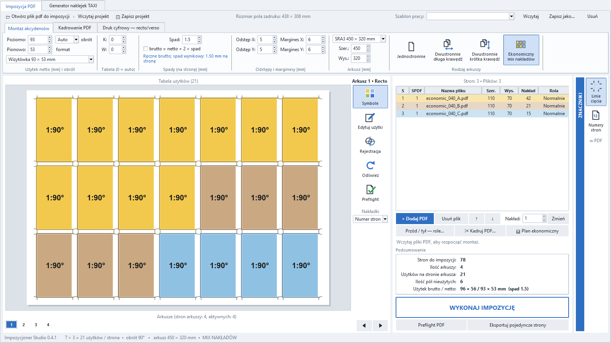

# Interfejs w stylu Impozycjonera 4



- **Wstęga u góry** — zakładki *Montaż akcydensów*, *Kadrowanie PDF*, *Druk cyfrowy — recto/verso*. Program jest nastawiony na prostą impozycję arkuszową (bez montażu książek). Pola mają strzałki ▲▼ (krok 0,5 mm; przesunięcie verso 0,1 mm).
- **Rodzaj arkuszy** — przyciski: Jednostronnie, Dwustronnie (długa / krótka krawędź), Ekonomiczny. Stare projekty w trybie Broszura nadal się otwierają i eksportują.
- **Tabela stron** po prawej — wiersz na każdą stronę PDF (S, SPDF, nazwa, wymiary, nakład, rola), kolor = plik. Dwuklik → role przód/tył, Delete → usuń plik. Kliknięcie użytku na arkuszu zaznacza jego stronę.
- **Symbole** (pasek przy podglądzie) — schematyczny podgląd: kolorowe użytki `strona:obrót°`, biała belka = góra strony. Wyłączone = prawdziwy render PDF.
- **Arkusze** pod podglądem — zakładki 1, 2, 3… (dwustronnie 1R / 1V), PgUp / PgDn.
- **Podsumowanie** i **WYKONAJ IMPOZYCJĘ** (= eksport PDF z preflightem). Szablony prac są w pasku u góry po prawej.

---

# Szablony prac

W górnym pasku okna, po prawej, jest pole **Szablon pracy** z przyciskami *Wczytaj / Zapisz jako… / Usuń*. Szablon to zapamiętany zestaw ustawień **jednej pracy**: format arkusza, netto, spad, odstępy, marginesy, obrót, siatka, tryb (jedno-/dwustronnie, broszura, ekonomiczny), sposób dopasowania PDF oraz znaczniki cięcia.

1. **Wczytaj** — wybierz szablon z listy i kliknij *Wczytaj*. Program ustawi pola i odświeży podgląd. Pliki PDF, ich nakłady i kadry zostają bez zmian.
2. **Zapisz jako…** — ustaw montaż, jak lubisz, i zapisz pod własną nazwą. Jeżeli w sekcji kalibracji wybrany jest profil maszyny, program zapyta, czy powiązać z nim szablon; przy wczytaniu szablonu ustawi wtedy także przesunięcie verso X/Y i krawędź odwracania z tego profilu. Gdy profilu nie ma na komputerze, dostaniesz ostrzeżenie, a kalibracja zostanie bez zmian.
3. **Usuń** — usuwa szablon użytkownika. Szablony wbudowane są tylko do odczytu.

**Wbudowane szablony** to punkty startowe (arkusz SRA3 450 × 320 mm, marginesy 6 mm, odstępy 5 mm, znaczniki włączone): wizytówka 93 × 53 z oryginału z kadrowaniem 1:1, wizytówki 90 × 50 i 85 × 55 oraz ulotki A6, DL i A5. Wersje „Bez skalowania” zakładają PDF-y z TrimBox równym netto. Zawsze sprawdź wynik w podglądzie i wydruk próbny.

Szablony użytkownika leżą poza projektami, lokalnie: `%APPDATA%\Impozycjoner Studio\job_templates.json`. Nie są wysyłane na GitHub. Szablon nie zawiera ścieżek do plików ani danych klienta.

---

# Impozycjoner Studio 0.4.1 — inteligentny panel Oryginał / Netto / Spad / Brutto

**Nowość 0.4.1: prawdziwe kadrowanie na podglądzie PDF z indywidualnym przesunięciem dla każdego pliku.**

1. Dodaj PDF-y. Zaznaczenie pliku po lewej pokazuje jego **rzeczywistą wielkość oryginału** (automatycznie odczytaną z PDF; program nie zmienia oryginału).
2. W prawym panelu ustaw **2. Wymiar netto**, np. **93 × 53 mm**. Możesz użyć presetu (wizytówki 93 × 53, 90 × 50, DL, A7, A6, A5, A4).
3. Wpisz **Spad na stronę**, np. **1,5 mm**. Dzięki włączonemu **Obliczaj brutto automatycznie** otrzymasz **96 × 56 mm brutto**, bez dodatkowego wpisywania. Gdy potrzebujesz innego spadu, zmieniasz jedno pole.
4. Wybierz **Sposób dopasowania PDF → Kadruj 1:1**. Z lewej zaznacz plik i kliknij **✂ Kadruj wybrany PDF (podgląd)**.
5. W nowym oknie zobaczysz rzeczywistą stronę PDF i dwie ramki: **turkusowa = brutto**, **pomarańczowa = netto**. Przeciągnij je myszą lub wpisz precyzyjnie X/Y w mm (krok 0,1 mm). **Zapisz kadr**.
6. Podgląd arkusza, preflight, eksport stron i montaż wektorowy używają tych samych pozycji kadru. Po zapisaniu projektu `.psimp` kadry różnych plików są odtwarzane osobno.

**Przykład:** oryginał **110 × 70**, netto **93 × 53**, spad **1,5** → brutto **96 × 56**. Domyślny kadr jest wyśrodkowany, czyli obcina po 7 mm wokół oryginału. Kadr X=+3 mm przesuwa wybór w prawo na PDF, a Y=−2 mm — w górę; wynikowego PDF **nie skaluje**.

**Przełączniki trybu zaawansowanego:** można wyłączyć automatyczne wykrywanie oryginału, by ręcznie sprawdzać wymiary źródła, albo wyłączyć automatyczne brutto, by ustawiać brutto samodzielnie. Stare projekty zachowują dotychczasowy sposób interpretacji brutto/netto i ręcznej walidacji oryginału. W trybie automatycznym można wczytać wiele PDF-ów o różnych **oryginalnych** rozmiarach.

**Ważne ograniczenie 0.4.1:** *wspólny format netto/brutto i siatka użytków dla całego montażu*; niezależne dla plików są rozmiary źródeł i pozycje kadru. Mieszanie różnych **docelowych fizycznych** wymiarów na jednym arkuszu (np. 90×50 obok 70×40) będzie osobną wersją z nowym silnikiem rozmieszczania. Kadrowanie wizualne bazuje na pierwszej stronie wybranego PDF-a; ustawiony offset działa na wszystkie strony tego pliku. Zakładka TAXI jest nietknięta.

**Bezpieczeństwo:** przy braku miejsca na cały użytek ze spadami program odrzuca kadrowanie — nie generuje sztucznej grafiki ani rozciągniętych elementów. Kontury i tekst PDF pozostają wektorowe. Sprawdź pierwszy wydruk próbny.

[Demo oryginału 110 × 70](examples/crop_041_source_110x70.pdf) · [wynik 96 × 56](examples/crop_041_result_96x56.pdf) · [montaż SRA3](examples/crop_041_sheet_SRA3.pdf) · [projekt `.psimp`](examples/crop_041_project.psimp).

---

# Impozycjoner Studio 0.4.0 — montaż ekonomiczny wielu projektów

**Nowość 0.4.0:** nowy tryb **Ekonomiczny** miesza wiele osobnych PDF-ów i wielostronicowych plików na wspólnym arkuszu, przy uwzględnieniu nakładu każdego wzoru. Każda niepominięta strona wielostronicowego PDF-a otrzymuje osobno podaną liczbę sztuk (nakład pliku). Przykładowo: A = 700 szt., B = 300 szt., w obu plikach po jednej stronie. Program przydzieli użytki do kolejnych arkuszy w proporcjach zamówienia, bez wymuszonej nadprodukcji.

## Montaż ekonomiczny — obsługa

1. Dodaj pliki PDF. Zaznacz każdy w lewej liście i ustaw **Nakład pliku**, np. 700, 300, 150. Dla wielostronicowego pliku nakład stosuje się **do każdej niepominiętej strony**, a nie do całej książki.
2. W prawym panelu w polu **Tryb** wybierz **Ekonomiczny**. W tej wersji jest to wyłącznie druk **jednostronny**, wspólna geometria użytku (jedno netto/brutto/spad dla wszystkich plików).
3. Ustaw arkusz SRA3/SRA4 lub inny oraz netto, brutto, spad i tryb kadrowania. Różne rozmiary oryginalnych PDF-ów można skalować jawnie; w trybie **Kadruj 1:1** kontrolowane są również ustawione wymiary oryginału i to, czy mieści się wybrany użytek brutto.
4. Kliknij **📊 Plan ekonomiczny / nakłady**. Otrzymasz liczbę fizycznych arkuszy, wykorzystanie pól oraz liczbę sztuk każdego wzoru. Można również zapisać raport CSV do Excela.
5. Wykonaj **Preflight PDF** i **Eksportuj PDF**. Eksport zawiera **każdy fizyczny arkusz drukowany raz** — nie ustawiaj dodatkowych kopii w sterowniku drukarki! Obok wyniku `montaz.pdf` powstaje `montaz_plan_ekonomiczny.csv`.

Przykład do testowania: [projekt `.psimp`](examples/economic_040_project.psimp), [trzy wejściowe PDF-y](examples/), [wynik SRA3](examples/economic_040_montaz_SRA3.pdf), [plan Excel/CSV](examples/economic_040_plan.csv) i [podgląd](examples/economic_040_podglad.png). Przykład: 42 A + 21 B + 15 C = 78 użytków na 4 arkuszach SRA3 po 21 pól, 6 pustych pól, nadprodukcja **0**. Oryginały 110 × 70 mm, brutto 96 × 56 mm, netto 93 × 53 mm, spad 1,5 mm.

**Bezpieczeństwo:** jeśli ręczne przypisania zmienią liczbę wydrukowanych wzorów, preflight i eksport zablokują nakład. Ręczne **zamienianie użytków** i zmiana ich geometrii są dopuszczalne przy zachowaniu ilości. Limit bezpiecznego automatycznego montażu ekonomicznego wynosi 10 000 fizycznych arkuszy na jeden eksport; większy nakład należy podzielić.

**Zakres i ograniczenia 0.4.0:** automatyczne mieszanie dotyczy **jednego formatu użytku na arkuszu** oraz drukowania jednostronnego, a nie dowolnych różnych formatów i ich geometrycznego nesting. Liczba arkuszy jest minimalna przy stałej siatce (`ceil(suma sztuk / pola arkusza)`), natomiast algorytm nie optymalizuje jeszcze liczby zmian wzoru, kolejności cięcia ani kosztu uruchomienia maszyny. Tryby Dwustronnie, Broszura oraz zwykła impozycja pozostają niezależne i niezmienione.

---

# Impozycjoner Studio 0.3.7 — arkusz testowy recto/verso i kalkulator kalibracji

**Nowość 0.3.7.** W głównym oknie, w **DUPLEX I ZNACZNIKI → KALIBRACJA RECTO / VERSO**, dostępne są dwa przyciski:

1. **1. Arkusz testowy PDF** — generuje dwustronicowy plik wektorowy w aktualnym formacie papieru, np. SRA3 320 × 450 mm. Na przodzie drukuje pięć krzyży kontrolnych A–E, z podziałką co 1 mm od −5 do +5 mm. Na tyle drukuje odpowiadające im pierścienie; uwzględnia **długą/krótką krawędź** oraz **już ustawione offsety X/Y**, więc można mierzyć ponownie po kalibracji. Arkusz testowy jest oddzielnym plikiem PDF, bez zawartości projektu klientów.
2. **2. Wpisz pomiar** — przykładając dwustronny wydruk do światła, patrz **od przodu** i zmierz przesunięcie **środka pierścienia TYŁU względem krzyża PRZODU**. Wpisz: w prawo `+X`, w lewo `−X`, w dół `+Y`, w górę `−Y`. Wpisz średni wynik z kilku punktów, w mm i z dokładnością 0,1 mm. Kalkulator automatycznie przeliczy znaki zgodnie z wybraną krawędzią i orientacją arkusza, **doda poprawkę do aktualnych offsetów** i zastosuje nowe wartości w projekcie.

**Instrukcja do wydruku:** ustaw tryb **Dwustronnie**, papier dokładnie taki jak w programie, skalowanie drukarki **100% / rozmiar rzeczywisty** (bez „Dopasuj do strony”, automatycznego obrotu czy skalowania do obszaru zadruku) i taką samą krawędź odwracania w sterowniku i Impozycjonerze. Po naświetleniu/przyłożeniu pod światło porównaj punkty A–E. Jeżeli różnice pomiędzy narożnikami nie są podobne, oznacza to problem z ukosem/niejednorodnym prowadzeniem papieru, którego jeden globalny offset X/Y **nie wyrówna**. Wtedy nie stosuj samej średniej w ciemno; zweryfikuj mechanikę podawania i ustawienia sterownika.

**Przykład obliczenia:** przy arkuszu **320 × 450 mm**, **długiej krawędzi**, widocznym z przodu przesunięciu tyłu `X=+0,7 mm` i `Y=−0,4 mm` oraz początkowych offsetach 0, kalkulator ustawi **offset verso X=+0,7 mm i Y=+0,4 mm**. To wynika z odwrócenia współrzędnej X przy oglądaniu tyłu od przodu. Przy poziomym arkuszu lub krótkiej krawędzi znaki mogą być inne.

**Zapis i bezpieczeństwo:** po zastosowaniu pomiaru zapisz profil przyciskiem **Zapisz**, a projekt przez **Zapisz projekt**. Żadne hasła ani dane produkcyjne nie są zapisywane na arkuszu testowym. Dotychczasowy montaż, spady, ręczny edytor i **generator TAXI pozostają bez zmian**. Test wykonaj na docelowej maszynie; kalkulator nie wykrywa automatycznie przesunięć z kamery ani skanu.

[Przykład arkusza testowego SRA3](examples/duplex_037_320x450.pdf) jest w katalogu `examples/`.

---

# Impozycjoner Studio 0.3.6 — kalibracja recto/verso dla maszyn

**Generator TAXI pozostał bez zmian.** W prawym panelu **DUPLEX I ZNACZNIKI** znajdziesz teraz **KALIBRACJA RECTO / VERSO**.

1. Wybierz **Tryb: Dwustronnie** oraz właściwą **krawędź odwracania**.
2. Wpisz **Przesunięcie verso X / Y** w milimetrach. Krok **0,1 mm**, zakres od **−20 do +20 mm**. **+X** przesuwa grafikę w prawo na *gotowym arkuszu verso w PDF*, a **+Y** w dół. Przykład: `X = 0,7`, `Y = -0,4`.
3. Kliknij **Odśwież podgląd** i włącz **Rejestracja ON/OFF**, żeby nałożyć przód i odpowiednio odwrócony tył. Zrób kontrolny wydruk dwustronny. **Spasowanie po druku zależy od sposobu obracania papieru w urządzeniu**; ustawienia trzeba potwierdzić na maszynie.
4. Zapisz osobny profil drukarki przyciskiem **Zapisz**. W przyszłości wybierz nazwę z listy i kliknij **Wczytaj**. Profil zawiera offsety X/Y oraz sposób odwracania arkusza. Przycisk **Usuń** usuwa wybrany profil.
5. Zapisz projekt `.psimp` — bieżąca kalibracja przechodzi do projektu, niezależnie od profili. Dotychczasowe projekty bez kalibracji pozostają z offsetem 0,0 mm.

**Jak działa korekta:** przesuwa **całą stronę verso** (grafikę użytków, spady i znaczniki cięcia) po obliczeniu automatycznego odwracania i ręcznych przesunięć pojedynczych użytków. **Recto pozostaje bez zmian**, a kadrowanie 1:1, format brutto/netto, przypisania PDF i numery stron są zachowane. Dla trybu Jednostronnie i Broszura globalna kalibracja duplex **nie zmienia eksportu**. Eksport pojedynczych stron też nie jest przesuwany.

**Kontrola bezpieczeństwa:** program blokuje wyjście zajętego użytku wraz ze spadem poza krawędź arkusza (w preflight oraz bezpośrednio w eksporcie). Wydruki próbne są niezbędne — program nie mierzy rzeczywistych odchyłek mechanicznych ani nie kalibruje drukarki automatycznie.

Profile zapisywane są lokalnie na Windows w `%APPDATA%\Impozycjoner Studio\duplex_profiles.json`; nie są wysyłane na GitHub i nie zawierają haseł. Przykład znajdziesz w `examples/kalibracja_036_*.pdf`, `*.psimp` i w obrazie `kalibracja_036_nalozenie.png`.

---

# Nowość 0.3.5 — interaktywny montaż PDF i niezależne recto/verso

**Generator TAXI bez zmian.** Kliknij **Edytuj użytki (przeciągnij)** nad podglądem arkusza:

1. Wybierz stronę w lewej kolumnie listy plików (w oknie edytora znajduje się po prawej stronie), przeciągnij na wybrany użytek. Możesz używać również pustych pól siatki.
2. Przeciągnij istniejący użytek na inny, aby **zamienić zawartość**. Przeciągnij go w wolną przestrzeń lub trzymaj **Shift** podczas przeciągania, aby **przesunąć** zawartość wraz z liniami cięcia.
3. Zaznacz użytek. Wpisz X / Y w milimetrach lub przesuń go strzałkami **co 0,1 mm**. Wciśnij `R` / przycisk ±90°, aby zmienić jego obrót. Obrót zachowuje rozmiar grafiki; przy 90° zmienia się fizyczna orientacja prostokątnego pola.
4. Przejdź do drugiej strony przyciskami **◀ / ▶** w edytorze: przód i tył mają **niezależne** przesunięcia, obroty i przypisane PDF-y.
5. **Wyczyść** usuwa zawartość (przy zachowaniu pozycji), a **Przywróć automat** usuwa wszystkie ręczne zmiany danego pola.
6. Zapisz `.psimp` w oknie głównym. Ta sama geometria jest używana do podglądu i wektorowego eksportu PDF.

**Bezpieczeństwo produkcyjne:** edytor nie pozwala wysunąć użytku wraz ze spadami poza arkusz. Wykryte nakładanie się **zajętych** użytków jest oznaczone czerwonym obrysem i ostrzeżeniem preflight. Zamierzone zakładki można jednak pozostawić — przed drukiem sprawdź PDF kontrolny. Numery stron wyświetlane na półprzezroczystych nakładkach **nie wchodzą do PDF-a produkcyjnego**.

Ręczne modyfikacje są przypisane do **arkusza, strony recto/verso i pola siatki**. Jeżeli później zmienisz liczbę użytków w siatce, kolejność PDF-ów lub nakład, sprawdź ponownie wszystkie ręczne pola: mogą odnosić się do innych pozycji albo wymagać ponownego montażu.

---

# Nowość 0.3.5 — trzy wymiary w montażu (oryginał / brutto / netto)

W prawym panelu **KADROWANIE / WYMIARY** są trzy niezależne etapy w takiej kolejności:

1. **Oryginał PDF:** np. **110 × 70 mm**. Po dodaniu pliku rozmiar uzupełnia się automatycznie z TrimBox strony PDF; możesz wpisać go ręcznie, ale program sprawdzi zgodność z prawdziwym PDF-em.
2. **Użytek ze spadami (brutto):** np. **96 × 56 mm**. To obszar, który rzeczywiście jest pobierany z oryginału, i wielkość zajmowana przez pojedynczy użytek na arkuszu.
3. **Netto po docięciu:** np. **93 × 53 mm**. Oznacza końcowy wymiar po przycięciu.

**Spad z każdej strony** jest wyliczany automatycznie: `(96−93)/2 = (56−53)/2 = 1,5 mm`. Przy innych spadach wprowadź odpowiednio inne wymiary brutto. Różnica musi być taka sama w obu osiach.

Dla nowego projektu GUI domyślnie ustawia **brutto 96 × 56 / netto 93 × 53 / spad 1,5 mm** i **Kadruj 1:1**. Źródło jest pobierane z PDF. Oryginał 110 × 70 jest przycinany centralnie: odcinane jest po **7 mm** z każdej strony do brutto 96 × 56, a TrimBox kończy się o **1,5 mm** od brzegu brutto. Żadna grafika nie jest skalowana; wynikowy PDF zachowuje wektory.

**Kontrole produkcyjne:** przy błędnych wymiarach źródła, użytku większym od oryginału lub niesymetrycznym spadzie program blokuje eksport. Preflight rozróżnia oryginał, brutto i netto. W projektach `.psimp` zapisują się wszystkie trzy pary wymiarów; projekty ze starszych wersji pozostają obsługiwane.

Opcje `Dopasuj`, `Wypełnij` i `Bez skalowania` nadal są dostępne. W tych trybach obowiązuje wcześniejsze pole spadu; trzyetapowe wyliczanie spadu dotyczy trybu **Kadruj 1:1**.

---

# Impozycjoner Studio — opis pozostałych funkcji

Rozwijana **wersja alpha** niezależnej, darmowej aplikacji do impozycji PDF, wzorowanej funkcjonalnie na procesach znanych z programu Impozycjoner 4. Wersja 0.4.0 **nie jest jeszcze pełnym zamiennikiem Impozycjonera 4**. Nie zawiera jego kodu, plików ani znaków handlowych.

## Uruchomienie na Windows 10/11

1. Zainstaluj Python 3.11 lub nowszy z python.org (zaznacz *Add Python to PATH*).
2. Rozpakuj ZIP do folderu na komputerze.
3. Kliknij dwukrotnie **`START_WINDOWS.bat`**. Plik automatycznie instaluje zależności i uruchamia aplikację. Przy kolejnych uruchomieniach korzysta z tego samego środowiska.
4. Jeśli pip jest nieobecny w `.venv`, launcher sam spróbuje `ensurepip`, a w razie potrzeby odtworzy środowisko. Skrypt `BOOTSTRAP_WINDOWS.bat` służy do samego przygotowania/naprawy środowiska.
5. Aby wygenerować własny katalog z plikiem .exe uruchom **`BUILD_EXE_WINDOWS.bat`**, potem `dist/Impozycjoner-Studio/Impozycjoner-Studio.exe`.

## Co jest dostępne

- Import wielostronicowych PDF, wiele plików i różne nakłady.
- Arkusze predefiniowane: SRA3/SRA4/A3/A4/B2; dowolny rozmiar w mm.
- Automatyczna siatka z obrotem 0/90° wybierająca więcej użytków.
- Ręcznie ustawiane wymiary, spady, odstępy, marginesy i kolumny/wiersze.
- Aktualizowany podgląd prawdziwego wynikowego PDF.
- Montaż jednostronny i dwustronny z definiowaniem przodów, sparowanych tyłów oraz jednego wspólnego rewersu — całe pliki lub wybrane strony. Jeśli nic nie oznaczysz, działa dawne parowanie 1/2, 3/4. Obrót według wskazanej krótkiej/długiej krawędzi arkusza.
- Podstawowa broszura zeszytowa 2-up, oprawa zeszytowa; automatyczne puste strony do wielokrotności czterech.
- Linie cięcia (wektorowe), numery stron; wektorowy wynikowy PDF bez rasteryzacji zawartości.
- **Jawne skalowanie wielostronicowego PDF do innego formatu netto**: Bez skalowania (blokada niezgodnych formatów), Dopasuj (proporcjonalnie, cała treść, możliwe marginesy) lub Wypełnij (proporcjonalnie, przycięcie). Brak rozciągania w trybach skalowania.
- Presety formatów docelowych: A6 pion/poziom, A5 pion/poziom i A4 pion/poziom oraz wymiary własne.
- **Eksportuj pojedyncze strony**: tworzy nowy wielostronicowy PDF, w którym każda strona ma docelowy format netto (albo format netto + skonfigurowany spad). Alternatywnie można skalować bezpośrednio podczas montażu na arkuszu.
- Poprawna interpretacja MediaBox z przesuniętym początkiem (również przy CropBox/TrimBox/BleedBox) — bez fałszywego błędu TRIMBOX; ten sam układ jest stosowany przy eksporcie.
- **Preflight PDF**: kontrola wymiarów TrimBox każdej strony, dostępnego fizycznego spadu, uproszczone DPI obrazów i fontów, TXT/JSON; błędy geometrii blokują eksport, a ostrzeżenia wymagają potwierdzenia.
- **Preflight 0.2.3**: raport ostrzega, gdy jeden PDF zawiera różne rozmiary stron (np. strony 1–12 A4 i 13–22 A6). Ostrzeżenia DPI są zgrupowane na stronę, a kompletne dane każdego problematycznego obrazu (w tym efektywne DPI po skalowaniu, położenie w pt i wymiary pikselowe) pozostają w eksporcie JSON.
- Poprawione umieszczanie spadów przy obrocie użytków 90/180/270° i źródłowych stron PDF z /Rotate; źródłowego PDF nie rozciągamy automatycznie, jeśli format nie pasuje.
- Zapis/odczyt projektu `.psimp` (archiwum ZIP + JSON, względne ścieżki PDF i przypisania roli każdej strony; oryginalne pliki nie są kopiowane do projektu).

## Ograniczenia — ważne w druku produkcyjnym

- Poprawka 0.2.1 została sprawdzona na syntetycznych PDF z przesuniętym MediaBox. Przed nakładem zawsze zweryfikuj plik kontrolny, zwłaszcza przy nietypowych eksportach DTP.

- Przed produkcją **sprawdź kontrolny PDF i wydruk dwustronny**, szczególnie orientację recto/verso na konkretnej maszynie.
- W tej wersji nie ma jeszcze gang-run, impozycji wykrojników, offsetowych paserów, pełnego preflightu CMYK/spot/ICC/PDF-X, creep ani kompletnych schematów falcowania.
- W trybie Dwustronnie strony oznaczone `Normalnie` są łączone w pary 1/2, 3/4 w ramach danego pliku/nakładu; osobne strony `Przód` są łączone z `Tył sparowany` w kolejności wybranych plików/stron. `Tył wspólny` jest tylko jeden na projekt i powtarza się pod wszystkimi przodami; w tej sytuacji nieoznaczone strony również stają się przodami. Zbyt mało sparowanych tyłów bez wspólnego tyłu powoduje błąd preflight. Przypisanie rewersu wymaga trybu **Dwustronnie**. W innych trybach działa jedynie `Pomiń`.
- W trybie broszury jest tylko jeden plik wejściowy, a ustawiona szerokość/wysokość użytku dotyczy **pojedynczej strony po złożeniu**. To prosty układ 2-up, bez korekcji creep.
- Program **nie tworzy nowych spadów z powietrza**. Jeśli źródło PDF nie ma fizycznego obrazu poza TrimBox, obszar spadu pozostanie pusty. Kontrola sprawdza dostępny obszar w geometrii pliku, **nie** potwierdza, że grafika faktycznie wypełnia spad.
- Preflight jest **uproszczony**: wykrywa część potencjalnie nieosadzonych fontów i niskie DPI rastrowe, ale nie zastępuje profesjonalnej inspekcji separacji, overprintu czy PDF/X. Próg DPI weryfikuje obrazki heurystycznie, nie analizuje całego wyglądu strony.
- Przy ustawieniu **Bez skalowania** rozmiar TrimBox źródłowego PDF musi odpowiadać użytkowi (tolerancja 0,5 mm). Przy różnych rozmiarach wyświetlany jest błąd. W trybach **Dopasuj / Wypełnij** operator jawnie decyduje o przeskalowaniu.
- Znaczniki przy małych odstępach mogą wchodzić w obszar innych użytków, dlatego przed produkcją wykonaj kontrolę podglądu.
- Przy dużych nakładach eksport odbywa się w głównym wątku GUI i może chwilowo blokować okno.

## 0.3.1 — Generator naklejek TAXI (Szczecin)

Osobna zakładka zastępująca **Generator etykiet z maili**. Bez logowania IMAP, bez podawania danych klientów.

### Generowanie w aplikacji

1. Otwórz **Generator naklejek TAXI**.
2. Wpisz jeden lub wiele numerów, np. `1740, 1713` (albo po jednym wierszu).
3. Kliknij **GENERUJ PLIKI TAXI → JEDEN ZIP** i wybierz miejsce zapisu.
4. Otrzymasz **jeden ZIP** z plikami luzem, bez osobnych folderów na numery.

Dla każdego numeru generator tworzy:
- `<NUMER>_lewy.tif`
- `<NUMER>_prawy.tif`
- `<NUMER>_tyl.svg`

Boki pozostają TIFF-ami 2283 × 1102 px, 200 DPI, z zachowanym herbem Szczecina i napisem SZCZECIN; podmieniany jest tylko numer.

Tył jest teraz **wyłącznie SVG** i ma jedną wersję, **bez lustrzanego odbicia**. Geometria tylnej naklejki jest stała:
- numer TAXI ma zawsze **55 mm wysokości**,
- napis `SZCZECIN` ma zawsze **120 mm szerokości**.

Wygenerowane napisy i liczby są obrysami wektorowymi (nie bitmapami, nie aktywnym fontem). Oryginalny CDR nie jest dołączany, nie generujemy natywnego CDR.

**Font:** oryginalny wzór był wykonany w *Impact*. Na typowym Windows program używa systemowego `C:\Windows\Fonts\impact.ttf` i przelicza jego obrysy na ścieżki bez kopiowania fontu. Jeśli Impact nie jest dostępny, można wskazać plik `Impact.ttf` z uprawnionej instalacji Windows. Na Linux/testach używany jest font zastępczy — takie pliki **nie są 1:1 zgodne wizualnie** z oryginałem.

**CorelDRAW X4 / ploter:** generator zapisuje tył jako SVG. Przy pierwszym użyciu zaimportuj `.svg`, sprawdź rzeczywisty wymiar linii cięcia i zrób próbne cięcie. **Nie rozpoczynaj produkcji bez kontroli na swojej maszynie.**

### Generowanie z konsoli

```powershell
python taxi_generator.py 1740 1713 -o TAXI_zamowienie.zip
```

Wygenerowany ZIP zawiera wskazane numery i tylko ich dedykowane pliki. Wzory źródłowe boków są w `assets/taxi`.

## 0.2.4 — przód / tył: dwa pliki i jeden wspólny rewers

1. Ustaw **Tryb → Dwustronnie**.
2. Dodaj PDF `Przody.pdf` i PDF `Tyl.pdf`.
3. Zaznacz `Przody.pdf`, kliknij **Przód / tył — role pliku i stron…**. Wybierz `Przód`, kliknij **Ustaw rolę CAŁEGO PLIKU** i **Zapisz przypisanie**.
4. Dla pliku `Tyl.pdf` z **jedną stroną** ustaw rolę całego pliku **Tył wspólny**. Jeżeli tyły są różne, wybierz zamiast tego **Tył sparowany** dla PDF zawierającego tyle samo stron co przody.
5. Sprawdź **Odwracanie arkusza**, przewiń podgląd na verso, zrób **Preflight PDF** i eksport.

### Gdy jeden PDF ma 22 strony, a np. strona 13 jest wspólnym tyłem

- Zaznacz plik i otwórz **Przód / tył — role pliku i stron…**.
- Wybierz `Tył wspólny`, wpisz zakres `13`, kliknij **Zastosuj do zakresu** i zapisz.
- Pozostałe strony mogą mieć rolę `Normalnie`: silnik potraktuje je jako przody, a stronę 13 wydrukuje na każdym odpowiadającym verso. Strony nie zmieniają kolejności.
- Jeśli ma być inaczej, oznacz wybrane strony jako `Przód`, `Tył sparowany` lub `Pomiń`.

Role można przypisać do **całego pliku**, wielu **zaznaczonych stron** lub wpisując zakres `1,3-8,22`. Stare projekty `.psimp` zachowują dawną kolejność bez przypisanych ról.

Przykładowe materiały znajdziesz w `examples/role_demo_*.pdf` i `examples/role_demo.psimp`.

**Ważne w produkcji:** poprawność ułożenia verso zależy od podawania i obracania arkusza przez konkretną maszynę. Sprawdź wydruk próbny z numerami/punktami rejestracyjnymi przed całą serią. Ten etap nie zastępuje jeszcze edytora użytków/arkuszy z Impozycjonera 4.

## Przykład: 22-stronicowy A4 do A6

1. Wczytaj wielostronicowy PDF A4 (22 strony). Nie trzeba dzielić go na osobne pliki.
2. W zakładce **UŻYTEK / STRONA** wybierz **A6 105 × 148 mm**.
3. Wybierz **Skalowanie PDF → Dopasuj**. W tym przykładzie stosowana skala ≈49,83%; treść zostaje w całości, na bokach mogą zostać białe marginesy ok. 0,18 mm. Alternatywa **Wypełnij** to skala 50% i przycięcie po 0,25 mm od góry/dołu.
4. Zaznacz spad **0 mm**, jeżeli chcesz otrzymać zwykłe strony A6 bez dodatkowych milimetrów. Jeśli druk wymaga spadów, ustaw ich wartość i zweryfikuj je w preflight: skalowanie nie potrafi utworzyć brakującego obrazu.
5. Kliknij **Preflight PDF**, a następnie **Eksportuj pojedyncze strony** — otrzymasz PDF A6 z 22 kolejnymi stronami, bez impozycji. Możesz też kliknąć **Eksportuj PDF**, żeby wykonać montaż na arkuszu SRA3/SRA4.

Wynikowy tekst/wektory nie są rasteryzowane. Fotografie zachowują istniejącą liczbę pikseli, więc zmienia się tylko ich fizyczna wielkość i efektywna rozdzielczość w druku. Tryb **Wypełnij** może usuwać treść przy samych krawędziach — przed nakładem sprawdź podgląd PDF.

## Testy

```powershell
.venv\Scripts\python.exe -m pip install pytest
.venv\Scripts\python.exe -m pytest -q
```

## Architektura

- `engine.py` — geometria arkusza, plan stron, osadzanie stron PDF i eksport, format projektów.
- `preflight.py` — podstawowa diagnostyka PDF i raporty TXT/JSON.
- `taxi_generator.py` — generator boków TIFF i tylnego SVG dla numerów TAXI.
- `taxi_ui.py` — zakładka generatora TAXI.
- `app.py` — interfejs desktopowy (Tkinter + Pillow).
- `tests/` — automatyczne testy regresyjne PDF.
- `ROADMAP.md` — moduły planowane do pełnej parytetowej funkcjonalności.

## ArtCraft

Inspiracja dotyczy podejścia: lokalny program, otwarty kod, brak abonamentu i profesjonalny interfejs. **Obecna wersja jest napisana w Pythonie**, nie w Rust. Port na Rust/egui jest możliwy po ustabilizowaniu algorytmów, ale nie został tu zrobiony.

## GitHub — osobny projekt

Docelowe repozytorium: https://github.com/Davidgracz/impozycjoner

Aby opublikować lokalne zmiany ze swojego Windowsa, uruchom **`GITHUB_PUBLISH_WINDOWS.bat`**. Skrypt:

1. Sprawdza Git i instaluje (jeśli potrzeba) GitHub CLI przez `winget`.
2. Prosi o zalogowanie do GitHub w przeglądarce (jeżeli nie jesteś zalogowany).
3. Tworzy lokalne repozytorium i pierwszy commit.
4. Rozpoznaje istniejące repozytorium `Davidgracz/impozycjoner`.
5. Przesyła lokalne zmiany na gałąź `main` tylko gdy historia GitHuba pozwala na bezpieczny push (bez `--force`).

Jeśli repozytorium już istnieje, skrypt próbuje zwykły `git push`, **bez `--force`**.

Po pierwszej publikacji zwykły workflow to `git add .`, `git commit -m "Short English change note"`, `git push`. GitHub Actions uruchamia testy na Windows i Linux dla Python 3.11/3.13.

**Prywatność:** w repozytorium nie ma lokalnego `.venv`, danych logowania ani cudzych plików klientów. Przykładowe PDF-y są sztuczne. Prawa/licencję otwartoźródłową ustalimy przed ewentualnym udostępnieniem repo publicznie.


## Przykład: strony A4 i A6 wymieszane w jednym PDF

Jeśli preflight pokazuje strony 1–12 A4 i 13–22 A6, wybór docelowego **A4** sprawi, że strony 13–22 zostaną **powiększone do około 200%**, co może silnie obniżyć efektywne DPI fotografii. Jeśli produkt ma być A6, wybierz docelowy **A6 105 × 148 mm** i skalowanie **Dopasuj**: pierwsze strony zostaną pomniejszone, a kolejne pozostaną zbliżone do 100%.

Raport TXT ma **jedną uwagę DPI na stronę**, zawierającą liczbę problematycznych obrazów i ich minimalną efektywną rozdzielczość. To porządkowanie komunikatów, a nie poprawa jakości pliku. Szczegółowe informacje o każdym obrazie można zapisać w pliku JSON (`image_issues`). Obrazy i logotypy o niskiej rozdzielczości nadal wymagają ręcznej kontroli.

## Edytor użytków i kontrola recto/verso (0.3.1 alpha)

- W zakładce **Impozycja PDF** naciśnij **Edytuj użytki** nad podglądem arkusza.
- Wybierz pole w tabeli, plik i numer strony, następnie **Przypisz stronę**.
- **Puste pole** usuwa zawartość wybranej pozycji, **Zamień** podmienia dwie pozycje, a **Przywróć auto** cofa indywidualne nadpisanie.
- Strzałkami ◀ ▶ przechodzisz po kolejnych stronach arkuszy, w tym po recto i verso. Edycja tyłu nie zmienia przodu.
- **Rejestracja ON/OFF** w trybie Dwustronnie pokazuje nałożone półprzezroczyste recto i odwrócone verso do kontroli spasowania. To podgląd inspekcyjny — nie wpływa na eksport.
- **Zapisz projekt** zapisuje ręczne przypisania do `.psimp` i ponowne otwarcie je przywraca.
- Ręczne użytki trafiają do tego samego silnika renderującego w podglądzie i eksporcie PDF.

**Zakres tego wydania:** ręczna edycja pozycji siatki, a nie swobodne przesuwanie współrzędnych lub drag-and-drop. Nie ma jeszcze regulacji rotacji dla pojedynczego użytku, osobnych nakładów montażu mieszanego czy kalibracji przesunięć duplex w mm. Po zmianie rozmiaru siatki warto sprawdzić stare przypisania.

**Generator TAXI pozostawiono bez zmian** względem dołączonej wersji 0.2.8.

## 0.3.2: Nakładki numerów w podglądzie

W pasku podglądu wybierz **Brak**, **Numer strony** lub **Plik + numer**. Duże półprzezroczyste oznaczenia nanoszone są wyłącznie na rastrowy podgląd użytków (również recto/verso). **Nie trafiają do eksportowanego PDF**.

- `duplex_calibration.py` — lokalne profile offsetu X/Y i krawędzi odwracania dla maszyn.
